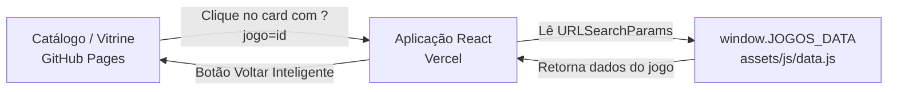

# ⚛️ SPRINT 06 – HOSPEDANDO REACT E ARQUITETURA HÍBRIDA: PLATAFORMA IARA GAMES

Este documento detalha as decisões da **Sprint 06** do projeto Iara Games, cujo foco principal foi a aplicação prática do **React** com **Vite**, componentização, arquitetura distribuída (*strangler pattern*) e integração dinâmica orientada a dados a partir de uma base centralizada.

**Equipe Master3:** Ingrid Silva de Lima, Larissa Cristina Benedito e Mayla Mayumi Motobe.

---

## 🔗 Acessos e Entregas

- 🌐 **Deploy Principal (GitHub Pages):** [https://mewmewdevart.github.io/IaraGamesStore/](https://mewmewdevart.github.io/IaraGamesStore/)
- ⚛️ **Deploy da Aplicação React (Vercel):** [https://iara-games-store.vercel.app/?jogo=pocket-bravery](https://iara-games-store.vercel.app/?jogo=pocket-bravery)
- 💻 **Repositório GitHub:** [https://github.com/mewmewdevart/IaraGamesStore](https://github.com/mewmewdevart/IaraGamesStore)
- 📖 **Documentação da Sprint:** [Visualizar Documentação Completa (PDF)](./Sprint%2006%20-%20Iara%20Games_2026%20-%20EAD.pdf)

---

## 1. 📌 Análise de Requisitos e Objetivos da Sprint

Nesta etapa, o desafio consistiu em introduzir uma biblioteca moderna (React) em um ecossistema já consolidado em HTML/CSS/JS tradicional, explorando:

- **Estratégia de Migração Gradual (*Strangler Fig Pattern*):** Em vez de reescrever toda a aplicação, desacoplou-se a tela mais densa e complexa (detalhes do produto) para uma SPA em React na Vercel, mantendo as páginas institucionais e o catálogo no GitHub Pages.
- **Eliminação de Duplicação de Dados:** Evitar criar bancos de dados ou objetos paralelos no React, mantendo a consistência absoluta dos 120 títulos cadastrados.
- **Navegação Fluida entre Domínios Diferentes:** Garantir que o usuário transite do GitHub Pages para a Vercel e consiga retornar facilmente ao catálogo sem interrupções.

---

## 2. 🚀 Funcionalidades Implementadas

A equipe desenvolveu a tela de detalhes dinâmicos com os seguintes recursos:

- **Renderização Orientada a Dados:** Um único componente React atende dinamicamente a todos os 120 jogos do catálogo a partir do parâmetro `?jogo=<id>` capturado da URL via `URLSearchParams`.
- **Exibição Completa do Produto:**
  - Título oficial, desenvolvedora, capa e sinopse temática;
  - Avaliação média em estrelas e volume total de votos;
  - Gêneros e tags temáticas;
  - Preço atual, preço original tachado e badge percentual de desconto;
  - Plataformas compatíveis (Windows, macOS, Linux, Mobile);
  - Requisitos de sistema e abas comunitárias.
- **Gestão de Estado Reativo (*React Hooks*):** Controles interativos para os botões *"Comprar agora"* / *"No carrinho"* e lista de desejos via `useState`, oferecendo feedback visual imediato.
- **Tratamento de Exceções e Acessibilidade:** Tela de erro amigável (*fallback* com atributo `role="alert"`) quando o jogo não é encontrado ou o parâmetro está ausente.
- **Navegação Inteligente de Retorno (*Cross-Domain*):** Botão *"Voltar para jogos"* que prioriza o histórico nativo (`history.back()`) se o usuário veio do catálogo, ou redireciona explicitamente para a URL absoluta do catálogo no GitHub Pages.

---

## 3. 🏗️ Arquitetura Híbrida e Fonte Única da Verdade

- **Single Source of Truth (`data.js`):** O arquivo central `assets/js/data.js` expõe `window.JOGOS_DATA`. Tanto o catálogo tradicional quanto a aplicação React consomem a mesma estrutura de dados, garantindo que qualquer atualização no catálogo reflita instantaneamente em ambos os ambientes.
- **Pipeline com Vite:** Configurado para empacotar a aplicação React, injetar as dependências estáticas (`data.js`, Bootstrap, Font Awesome) e sincronizar os assets estáticos no build para produção.

---

## 4. 📁 Organização dos Arquivos Principais

| Arquivo / Diretório | Responsabilidade |
| :--- | :--- |
| `src/game-details.jsx` | Componente React principal que captura o slug na URL, gerencia estados e renderiza os detalhes do jogo. |
| `assets/js/data.js` | Base central com os dados, sinopses e metadados de todos os 120 jogos do catálogo. |
| `assets/css/game-details.css` | Folha de estilos dedicada aos detalhes do jogo com layout responsivo e transições. |
| `vite.config.js` | Configuração de build para a Vercel, resolução de entrada HTML e cópia de assets estáticos. |
| `package.json` | Definição das dependências do ecossistema React 18 e scripts de compilação. |

---

  <a href="./Sprint%2006%20-%20Iara%20Games_2026%20-%20EAD.pdf">📝 Visualizar documentação completa da Sprint 06 (PDF)</a>

  <a href="https://github.com/mewmewdevart/IaraGamesStore">💻 Acessar código-fonte no GitHub</a>

