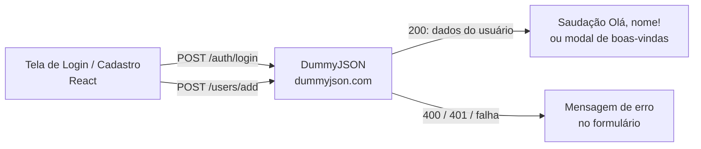

# 🔐 SPRINT 07 – DEPLOY COM API REAL: PLATAFORMA IARA GAMES

Este documento detalha as decisões da **Sprint 07**, etapa final do projeto Iara Games. O foco foi construir em **React** uma nova área da plataforma que consome uma **API real** — a tela de **login e cadastro**, integrada à API pública **DummyJSON** — e publicá-la online. Aproveitando esta fase, a equipe também **converteu todo o projeto para React** e **migrou a hospedagem do GitHub Pages para a Vercel**, reunindo todas as páginas em uma única aplicação e um único endereço.

**Equipe Master3:** Ingrid Silva de Lima, Larissa Cristina Benedito e Mayla Mayumi Motobe.

---

## 🔗 Acessos e Entregas

- 🌐 **Deploy da Plataforma (Vercel):** [https://iaragames-store.vercel.app/](https://iaragames-store.vercel.app/)
- 🔐 **Área desenvolvida – Login e cadastro:** [https://iaragames-store.vercel.app/login.html](https://iaragames-store.vercel.app/login.html)
- 💻 **Repositório GitHub:** [https://github.com/mewmewdevart/IaraGamesStore](https://github.com/mewmewdevart/IaraGamesStore)
- 📖 **Documentação da Sprint:** [Visualizar Documentação Completa (PDF)]((https://github.com/mewmewdevart/IaraGamesStore/blob/main/docs/Sprint_07_-_2_Semestre_-_Iara_Games_2026_-_EAD.pdf))
- 🛠️ **Documentação técnica da integração:** [Integração do Login e Cadastro com DummyJSON (PDF)](./docs/integracao_dummyjson_login.pdf)

---

## 1. 📌 Análise de Requisitos e Objetivos da Sprint

O desafio desta fase foi conectar tudo o que foi desenvolvido até aqui a uma fonte de dados externa, entregando uma funcionalidade dinâmica e pronta para uso:

- **Consumo de API real:** Escolhemos a sugestão de **autenticação simples**, com uma tela de login que valida usuários por meio de uma API mockada.
- **Deploy funcionando online:** A área precisava estar publicada e acessível por link público.
- **Unificação da plataforma:** Encerrar a arquitetura híbrida da Sprint 06 (GitHub Pages + Vercel), convertendo todo o projeto para React e publicando tudo em um único domínio na Vercel.

---

## 2. 🚀 Funcionalidades Implementadas

A tela fica na rota `/login.html` e reúne dois modos na mesma interface: **Entrar** e **Cadastre-se**.

- **Login:** Campos obrigatórios de usuário e senha; um login válido exibe a saudação *"Olá, [nome]!"* com o nome devolvido pela API.
- **Validação de credenciais:** Usuário ou senha incorretos exibem *"Usuário ou senha inválidos."*.
- **Cadastro:** Campos de usuário, e-mail e senha, com validação inicial feita pelo navegador. O modo é aberto pelo fragmento `#cadastro`.
- **Modal de boas-vindas:** Após o cadastro, mostra o nome retornado pela API e avisa que a conta é demonstrativa; fecha pelo botão *"Entendi"*, por clique fora ou pela tecla `Escape`.
- **Estado de carregamento:** Durante a requisição, o botão exibe *"Aguarde..."* e fica desabilitado, evitando envios repetidos.
- **Mensagens de erro:** Falhas de conexão ou respostas inesperadas aparecem no próprio formulário.

---

## 3. 🌐 Integração com a API DummyJSON



As requisições saem direto do navegador com `fetch`, método `POST` e cabeçalho `Content-Type: application/json`.

| Endpoint | Função e dados enviados |
| :--- | :--- |
| `POST /auth/login` | Autentica o usuário. Envia `username` e `password`. |
| `POST /users/add` | Cria uma conta demonstrativa. Envia `username`, `firstName`, `email` e `password` (o nome de usuário também vai como `firstName` para aparecer na saudação). |

- **Tratamento centralizado:** A função compartilhada `enviarParaApi` converte os dados em JSON, trata falha de conexão e resposta que não é JSON, e verifica `response.ok`, repassando o status HTTP e a mensagem de erro da API.

**Exemplo de requisição de login:**

```json
{ "username": "emilys", "password": "emilyspass" }
```

---

## 4. 📁 Organização dos Arquivos Principais

| Arquivo / Diretório | Responsabilidade |
| :--- | :--- |
| `src/pages/login/Login.jsx` | Formulários de login e cadastro, estados da interface, chamadas HTTP à API, mensagens e modal de boas-vindas. |
| `src/pages/login/Login.css` | Estilos das mensagens, do estado de carregamento e do modal de boas-vindas. |
| `src/routes/Rotas.jsx` | Inclui a tela de login na rota `/login.html` e trata o modo de cadastro por `#cadastro`. |
| `vite.config.js` | Configura a compilação e a geração da versão de produção. |
| `package.json` | Dependências do projeto e scripts npm. |

**Tecnologias:** React, React DOM, Vite, JavaScript (ES6+), Fetch API, API REST DummyJSON, HTML5 semântico, CSS3 e Vercel.

---

## 5. ☁️ Hospedagem e Como Testar

A plataforma está publicada na **Vercel**, conectada a este repositório. A cada novo commit na branch principal, uma nova implantação é gerada automaticamente.

| Configuração na Vercel | Valor |
| :--- | :--- |
| Framework Preset | Vite |
| Root Directory | `./` |
| Install Command | `npm install` |
| Build Command | `npm run build` |
| Output Directory | `dist` |

**Testar online:**

1. Abra [https://iaragames-store.vercel.app/login.html](https://iaragames-store.vercel.app/login.html).
2. **Login válido:** usuário `emilys` e senha `emilyspass` (credencial de teste da DummyJSON) → a tela mostra *"Olá, Emily!"*.
3. **Login inválido:** informe uma senha incorreta → a tela indica *"Usuário ou senha inválidos."*.
4. **Cadastro:** clique em *"Cadastre-se"*, preencha os campos e envie → o modal mostra o nome retornado e o aviso de conta demonstrativa.

**Executar localmente** (requer Node.js e npm; no PowerShell do Windows, use `npm.cmd` se o `npm` for bloqueado):

```bash
git clone https://github.com/mewmewdevart/IaraGamesStore.git
cd IaraGamesStore
npm install
npm run dev
# abra http://localhost:5173/login.html
```

Para gerar e conferir a versão de produção: `npm run build` e depois `npm run preview`.

---

## 6. ♿ Usabilidade, Acessibilidade e Validação

- **Identidade mantida:** Mesmo visual e cabeçalho do restante da plataforma.
- **Feedback imediato:** Carregamento no botão, saudação no sucesso e mensagem clara no erro.
- **Leitores de tela:** Erros com `role="alert"`, sucesso com `role="status"` e modal com `role="dialog"`, `aria-modal="true"` e `aria-labelledby`.
- **Preenchimento automático:** O campo de usuário usa `autocomplete="username"`.

**Validação realizada (09/11/2026):**

| Verificação | Resultado |
| :--- | :--- |
| `npm run build` | ✅ Concluído com sucesso pelo Vite |
| Login com `emilys` / `emilyspass` na API | ✅ HTTP de sucesso, com `firstName` e `username` |
| Login com senha inválida na API | ✅ Rejeitado com HTTP 400 |
| Cadastro demonstrativo na API | ✅ HTTP de sucesso, com identificador e dados simulados |
| Fluxo de login na tela React | ✅ Exibiu *"Olá, Emily!"* |
| Fluxo de cadastro na tela React | ✅ Modal com nome retornado e aviso de não persistência |

### ⚠️ Limitações conhecidas

- **Cadastro não persistente:** `/users/add` simula a criação; a conta não pode ser usada depois para entrar.
- **Sessão não persistente:** Os tokens retornados no login não são armazenados e as outras páginas não são protegidas.
- **Recuperar senha e "Lembrar de mim":** Ainda sem funcionamento.
- **Uso em produção:** Exigiria backend próprio e armazenamento seguro de credenciais; a DummyJSON serve apenas para demonstração.

---

## 📚 Referências

- [DummyJSON – Documentação oficial](https://dummyjson.com/docs) · [Autenticação](https://dummyjson.com/docs/auth) · [Usuários](https://dummyjson.com/docs/users)
- [MDN Web Docs – Fetch API](https://developer.mozilla.org/pt-BR/docs/Web/API/Fetch_API)
- [MDN Web Docs – ARIA](https://developer.mozilla.org/pt-BR/docs/Web/Accessibility/ARIA)
- [React – Documentação oficial](https://react.dev/)
- [Vite](https://vite.dev/)
- [Vercel – Documentação](https://vercel.com/docs)

---

<p align="center">
  <a href="(https://github.com/mewmewdevart/IaraGamesStore/blob/main/docs/Sprint_07_-_2_Semestre_-_Iara_Games_2026_-_EAD.pdf)">📝 Visualizar documentação completa da Sprint 07 (PDF)</a>
</p>

<p align="center">
  <a href="https://iaragames-store.vercel.app/">🌐 Acessar a plataforma online</a> ·
</p>

[🔙 Voltar para a (Sprint 06)](./06_sprint.md)
